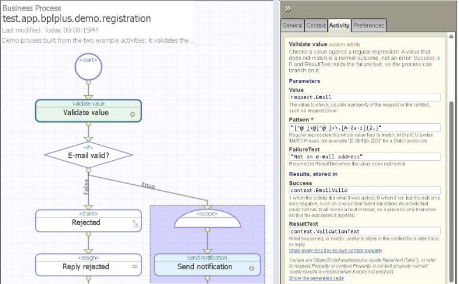
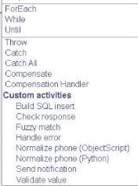
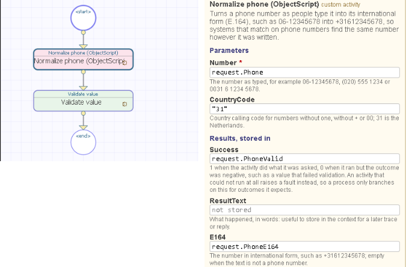
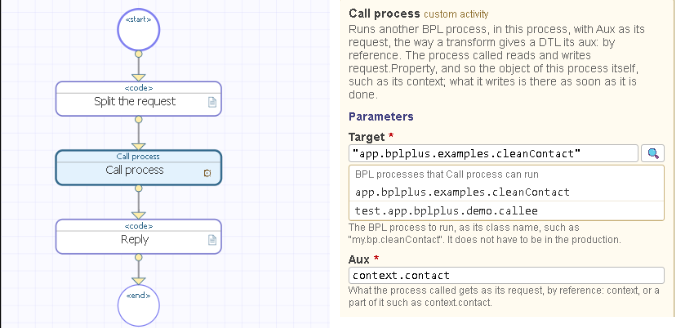
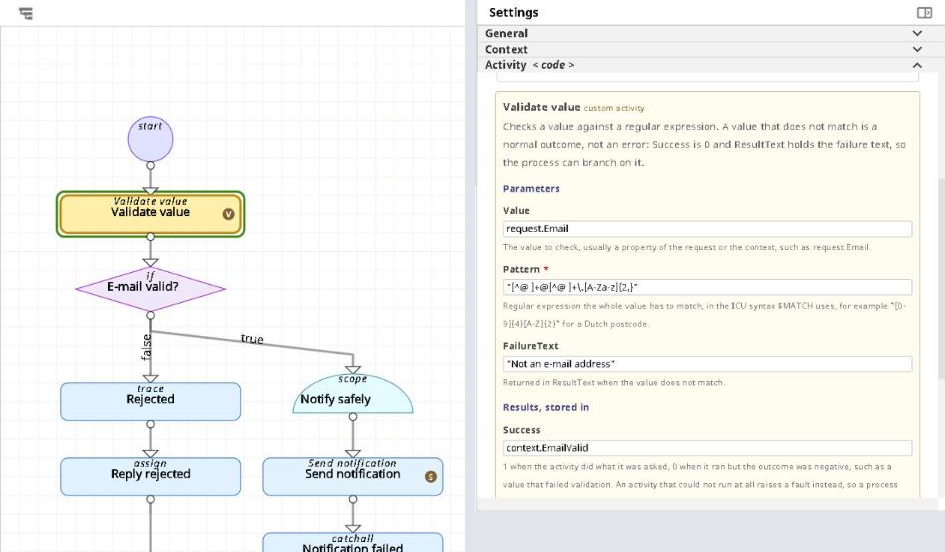
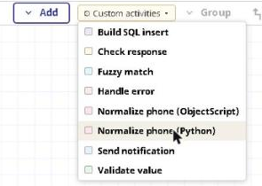

# BPL Plus

**Your own activities in the BPL Business Process Designer.**

Every interoperability team ends up with the same ObjectScript pasted into
`<code>` blocks all over their business processes: check this value, build that
statement, log the error and send an alert. Or they build a business operation
and a pair of message classes, just to call twenty lines of code.

BPL Plus turns that code into an activity you pick from the designer's menu.
Write one class. Its properties are the parameters, and its `Execute` method is
what it does. Compile it, and it shows up under **Custom activities**, with a
form instead of a code box:



*Validate value* above is a class of about forty lines. The process designer
fills in a value and a pattern, and picks the context properties that receive
the results. They don't write or see any code.

- **No registration and no production items.** Compile a class and reload the
  designer. The activity runs inside the business process itself.
- **Both designers.** The classic Zen designer and the new Angular BPL editor
  (2025.1 and later) show the same activities and the same form.
- **Results go straight to the context.** Each result gets a context property of
  its own when the activity is added, and the property is created for you.
- **Plain BPL on disk.** A process built with BPL Plus is ordinary BPL. It
  compiles, runs and opens without BPL Plus installed, so you are not locked in.
- **ObjectScript or Python.** Write an activity in either language. A Python one
  can even be a plain `.py` module with no ObjectScript class at all.

Tested on InterSystems IRIS 2025.1, 2026.1 and 2026.3.

## Try it with Docker

```
git clone https://github.com/mvweerd/iris-bplplus.git
cd iris-bplplus
docker compose up -d --build
```

Then open
[the demo process](http://localhost:9092/csp/user/EnsPortal.BPLEditor.zen?BP=test.app.bplplus.demo.registration.bpl)
and log in as `_SYSTEM` with password `SYS`. That is the portal's own designer
link, and it opens BPL Plus. The demo production is already running, so you can
send it test messages right away (see Trying it out). *Open in the new UI* takes
you to the same process in the new editor.

The image is built on `intersystemsdc/iris-community`. Set `IMAGE` in the
`Dockerfile` to try another IRIS version.

## A first activity in two minutes

```objectscript
/// Looks up a customer and returns its name.
Class my.steps.lookupCustomer Extends app.bplplus.activity
{

Parameter ACTIVITYCAPTION = "Look up customer";

Parameter ACTIVITYCOLOR = "#F3E5F5";

/// Customer number to look up.
Property CustomerId As %String [ Required ];

/// Which system to search.
Property Source As %String(VALUELIST = ",crm,erp") [ InitialExpression = "crm" ];

Method Execute(pProcess As Ens.BusinessProcess, Output pResult As app.bplplus.activityResult) As %Status
{
    Set pResult = ##class(app.bplplus.activityResult).%New()
    Set pResult.ResultText = "Customer "_..CustomerId_" found in "_..Source
    Quit $$$OK
}

}
```

Compile it and reload the designer. *Look up customer* is now in the menu:



The designer builds the form from the class:

| In the class | In the designer |
|---|---|
| `ACTIVITYCAPTION` | Menu entry and caption on the shape (the class name if empty) |
| First paragraph of the class comment | Tooltip in the menu, description above the form |
| Each public property | A parameter field |
| The property's comment | Help text under the field |
| `[ Required ]` | A red `*`. At run time the activity fails without a value |
| `InitialExpression` | Filled in when the activity is added |
| `VALUELIST` | Suggestions in the field, checked before the activity runs |
| XData `ActivityDefaults` | Defaults that refer to the process, such as `context.%LastError` (JSON of property name to expression) |
| `ACTIVITYRESULT` | Result class. Its properties become the "Results, stored in" fields |
| `ACTIVITYAUTOMAP` | `1` (default) stores every result in a context property of its own; `0` stores nothing until you name a property |
| `ACTIVITYCOLOR` | Fill colour of the shape |
| A property of type `app.bplplus.lookup` | A magnifier next to the field (see A magnifier on a parameter of your own) |

Field values are ObjectScript expressions, just like elsewhere in BPL. Quote
literal text (`"abc"`), or refer to `request.X` and `context.Y`.

`Execute` receives the business process it runs in, so it can log, send alerts
or read the process's settings. Return an error status when the activity could
not do its work; the process then raises a fault, and a catchall can handle it.
An outcome that is merely negative, such as a value that doesn't validate, is a
normal result: return `$$$OK` and set `pResult.Success = 0`. For more results,
subclass `app.bplplus.activityResult` and name it in `ACTIVITYRESULT`.

## Examples that come with it

These are installed with the module, and each one has a demo process in the demo
production (see Trying it out).

| Activity | What it does |
|---|---|
| *Validate value* | Checks a value against a regular expression. A mismatch is a result (`Success` = 0), not an error, so the process can branch on it |
| *Send notification* | The basics: a required parameter, a default and a value list |
| *Handle error* | The standard block for a catchall: fail with the error or only log it, optionally with an alert. Its default comes from `context.%LastError` |
| *Check response* | Fails when a value in an XML response is not what you expect, so a refused call isn't taken for a success. Namespaces in the path are ignored |
| *Build SQL insert* | One `INSERT` per XML record from a column list. Text is quoted, numbers are checked and a missing field is named. The statements come back as a stream, so large batches don't hit the string limit |
| *Fuzzy match* | The candidate most like a value, using Python's `difflib` |
| *Normalize phone (Python)* | `06-12345678` becomes `+31612345678`. Written as a plain Python module |
| *Normalize phone (ObjectScript)* | The same activity as an ObjectScript class, so you can compare the two. A test checks that they give the same answers |
| *Call process* | Runs another BPL process with an object of this one, by default the context, or a message as its request. The process called reads and writes that object itself, and its response comes back as a result (see below) |
| `registerContact`, `cleanContact`, `contact` | Example processes: `registerContact` gives `cleanContact` its `context.contact` to clean up, with *Call process* (see below) |
| `writeLetter`, `signLetter` | Example processes: `writeLetter` gives `signLetter` its `context.letter`, a stream, to sign, with *Call process* (see below) |
| `receiveOrder`, `checkOrder` | Example processes: `receiveOrder` gives `checkOrder` the HTTP message of an order to check, and gets its HTTP answer back, with *Call process* (see below) |

## Calling another process

*Call process* runs another BPL process inside the process it is in. It works
like `aux` on `<transform>`: you give it an object, **Aux**, and the process
called gets that object as its `request`, by reference. What that process writes
in `request` is written in the object of the caller. Aux is `context` unless you
give less, such as `context.contact`, or a message, such as `request`. When the
process called has a response, *Call process* gives it back as the result
**Response**.

| Parameter | What it is |
|---|---|
| **Target** | The BPL process to run. Pick it with the magnifier, which lists the processes that can be called |
| **Aux** | The object the process called gets as its `request`. By default `context` |

| Result | What it is |
|---|---|
| **Response** | The response of the process called, such as an `Ens.StringResponse`. Empty when it has no response class |
| **Success**, **ResultText** | As for every activity: 1, and which process ran |

A process that can be called is any BPL process of your own (the magnifier
leaves out those of IRIS). Its request class is the class of what you give as
Aux:

- a class of your own, such as a serial class with the fields it works on. The
  designer then knows the fields of `request`;
- a stream class such as `%Stream.Object`, to work on a stream of the caller;
- `%Library.RegisteredObject`, to take any object, such as the whole context of
  the caller. `request.Name` is then the caller's `context.Name`;
- a message, such as an `Ens.Request` or an `EnsLib.HTTP.GenericMessage`. Then
  the same process also works as an item of a production.

The process called does **not have to be an item of the production**. It runs in the job of
the calling process, under that process's name and settings, through the BPL
engine's own `OnRequest`, as the production would run it. No messages are sent
and nothing of it is stored.

Things to know:

- **The process called has to run straight through.** It cannot wait for a
  message or a timer, so a `<call>`, `<delay>` or `<receive>` in it makes *Call
  process* fail. Code, assigns, rules, transformations and custom activities
  work.
- Its trace and log entries carry the name of the calling item, as it runs there.
- Store **Response** in a context property of the response class of the process
  called, not of `%RegisteredObject`, which the designer adds by default. Only
  then is it kept when the calling process waits.
- A message in a context property is stored with the context. Clear the
  property (`Set context.check = ""`) once you are done with it, or the message
  table keeps rows that no message header points to.
- When the process called is given an object that is not of its request class,
  *Call process* fails before it runs, and says which class it expects.

### The example: a contact cleaned up by another process

Three example classes come with the module, in `app.bplplus.examples`:

- `contact` is a serial class with `Email` and `Phone`, and `PhoneE164`,
  `PhoneValid` and `EmailValid` for the outcome.
- `cleanContact` is the process to call. Its request class is `contact`. It puts
  `request.Phone` in international form with *Normalize phone*, checks
  `request.Email` with *Validate value*, and stores the results in `request`
  itself.

  

- `registerContact` calls it. It gets `e-mail, phone` in an `Ens.StringRequest`,
  puts the two in `context.contact`, and runs `cleanContact` with *Call process*,
  with `context.contact` as Aux. After that step `context.contact.PhoneE164` and
  `context.contact.EmailValid` are filled in, and the reply uses them.

  

To try it, add `app.bplplus.examples.registerContact` to a production (not
`cleanContact`) and send it `jan@example.com, 06-12345678`. The answer is
`+31612345678, e-mail valid`. The demo production has it as *Example register
contact*.

### The example: a letter signed by another process

The same works with a stream. Two more example processes show it:

- `signLetter` is the process to call. Its request class is `%Stream.Object`.
  It goes to the end of `request` and writes a closing and a signature there.
- `writeLetter` calls it. It gets a name in an `Ens.StringRequest`, writes
  `Dear <name>, Thank you for registering.` in `context.letter`, a
  `%Stream.GlobalCharacter`, and runs `signLetter` with `context.letter` as Aux.
  After that step the letter in its own context ends with `Kind regards, The
  registration desk`, and the reply is the whole letter.

The stream is not copied: `signLetter` writes in the caller's stream itself.
The demo production has it as *Example write letter*.

### The example: an order over HTTP checked by another process

A message works too. These two example processes take an order that comes in
over HTTP:

- `checkOrder` is the process to call. Its request and response are both
  `EnsLib.HTTP.GenericMessage`, as an `EnsLib.HTTP.GenericService` sends and
  expects them. It reads the method and `Content-Type` from `request.HTTPHeaders`
  and the JSON order from `request.Stream`, such as:

  ```json
  {"orderId": "A-1001", "lines": [{"sku": "PEN-01", "quantity": 3, "price": 1.25},
                                  {"sku": "PAD-02", "quantity": 1, "price": 4.5}]}
  ```

  It answers `200 OK` with `{"orderId":"A-1001","lines":2,"total":8.25}`. If the
  order is wrong, the answer is one of these, with `{"error": "..."}`:

  | Status | When |
  |---|---|
  | `405 Method Not Allowed` | The method is not POST |
  | `415 Unsupported Media Type` | `Content-Type` is not `application/json` |
  | `400 Bad Request` | The body is not a JSON object |
  | `422 Unprocessable Content` | A field is missing or wrong |

  The status goes in the `StatusLine` header, which the HTTP service uses as the
  status of its answer.
- `receiveOrder` calls it. It runs `checkOrder` with *Call process*, with
  `request`, the HTTP message itself, as Aux, and stores **Response** in
  `context.check`. For a good order it logs it and answers
  `202 Accepted` with `"status":"accepted"` added. Otherwise it passes on the
  status and error of `checkOrder`.

To try it over HTTP, add an `EnsLib.HTTP.GenericService` to a production with
`receiveOrder` as its target, and POST the order to it with
`Content-Type: application/json`. The demo production has *Example receive
order*, and its test sends the order the way the service would.

`checkOrder` is not in the demo production, but because it takes and gives
messages, you can also put it in a production of its own.

The demo production also has *Demo Call process*, which gives its whole context
to `test.app.bplplus.demo.callee`. That process has `%Library.RegisteredObject`
as its request class and writes a greeting, a line in a stream and an item in a
list straight into the caller's context.

### A magnifier on a parameter of your own

The magnifier runs the Management Portal's own context searches, the ones behind
the magnifiers on the settings of a production item. Give a parameter the type
`app.bplplus.lookup` with a `CONTEXT` in the portal's format, and its field
gets one:

```objectscript
/// The operation to send to.
Property Target As app.bplplus.lookup(CONTEXT = "Ens.ContextSearch/BusinessOperations");
```

Every search the portal has works, such as
`Ens.ContextSearch/ProductionItems?targets=1&productionName=@productionId`
(`@productionId` is the running production), credentials or lookup tables, and
so does one of your own: a class method in the form of `Ens.ContextSearch`.
Its top results come first in the list. Picking a value fills it in as a quoted
string.

## In the new BPL editor

The new editor (*Open in the new UI*) gets a **Custom activities** button next to
*Add*, and the same form in its Settings panel:





The form writes through the editor's own code field, so undo, redo, save and
compile work as usual.

## Writing activities in Python

Extend `app.bplplus.python.activity` and implement `Perform` in Python. The
parameters are attributes of `self`, and `result` is the result to fill in. An
exception fails the activity, with its message in the error.

```objectscript
Class my.steps.slugify Extends app.bplplus.python.activity
{

Parameter ACTIVITYCAPTION = "Make slug";

/// The text to turn into a URL slug.
Property Text As %String(MAXLEN = 1000) [ Required ];

Method Perform(process As Ens.BusinessProcess, result As app.bplplus.activityResult) [ Language = python ]
{
    import re, unicodedata
    plain = unicodedata.normalize("NFKD", self.Text).encode("ascii", "ignore").decode()
    result.ResultText = re.sub(r"[^a-z0-9]+", "-", plain.lower()).strip("-")
}

}
```

Or skip ObjectScript entirely. Put a class in a module of the `bplplus_steps`
package, and declare its parameters and results as attributes:

```python
# bplplus_steps/phone.py
import re
from bplplus import Activity, Param, Result

class NormalizePhone(Activity):
    """Turns a phone number as people type it into its international form."""
    caption = "Normalize phone (Python)"
    Number = Param(str, required=True, doc="The number as typed, such as 06-12345678.")
    CountryCode = Param(str, default="31", doc="Country code for numbers without one.")
    E164 = Result(str, doc="The number in international form, such as +31612345678.")

    def perform(self, process, result):
        digits = re.sub(r"[^\d+]", "", self.Number)
        ...
        result.E164 = "+" + number
```

Both designers list it like any other activity. `Param(type, default, required,
doc, choices)` converts and checks the values, so a missing required parameter,
a value of the wrong type or an unknown parameter fails the activity with a
clear message. Set `result.success = False` for a negative outcome. Names follow
the IRIS style (`Number`, `E164`) because the designer shows them as they are.

The modules live in the `python` directory of the IRIS installation; IPM copies
`src/python` there. The designer picks up a changed module when you reload it,
and a running production when its jobs restart. Being plain Python, the modules
can be tested without IRIS:

```
python -m unittest discover -s tests/python
```

This needs Embedded Python. On Windows, set the Python runtime once:
Management Portal > System Administration > Configuration > Additional Settings
> Advanced Memory, `PythonRuntimeLibrary` (for example
`C:\Python312\python312.dll`) and `PythonRuntimeLibraryVersion` (`3.12`).

## Install

With IPM, in a namespace that is enabled for interoperability:

```
zpm "install iris-bplplus"
```

or from a clone of this repository:

```
zpm "load /path/to/iris-bplplus"
```

The install also does two things for you:

- It creates the web application `/ui/interop/bpl-plus` for the new editor.
- It makes BPL Plus the default designer of the namespace, by setting
  `app.bplplus.classic.redirect` as the Event Class of `/csp/<namespace>`. It
  only does this when that application has no Event Class yet. An existing one
  is left alone, and the install tells you how to combine the two (see Making it
  the default designer). Uninstalling clears it again, but only if it is still
  ours.

Without IPM, use the deploy script (connection settings in `.env`, see
`.env.example`):

```
python scripts/deploy_bplplus.py            # the activities and the designers
python scripts/deploy_bplplus.py --tests    # plus the demo production and the tests
```

or load the classes from an IRIS terminal in the target namespace:

```
do $system.OBJ.ImportDir("<repo>/src/cls","*.cls","ck",.err,1)
do $system.OBJ.ImportDir("<repo>/tests","*.cls","ck",.err,1)
```

Then create the web application for the new editor by hand: Management Portal >
System Administration > Security > Applications > Web Applications > **Create
New Web Application**:

| Setting | Value | Why |
|---|---|---|
| Name | `/ui/interop/bpl-plus` | The editor finds its server by cutting its URL off at `/ui/interop` |
| Namespace | the namespace with these classes | One namespace owns the path. Its catalog serves every namespace that has the classes |
| Dispatch Class | `app.bplplus.angular.editor` | |
| Allowed Authentication Methods | **Unauthenticated** and **Password** | The editor's files are public anyway. The list of activities needs a logged-in user |
| Group By ID | `%ISCMgtPortal` | Your Management Portal login carries over, so there is no second login |

## Using it

### Classic designer

Open `/csp/<namespace>/app.bplplus.classic.editor.zen`, or open a business
process from the portal as usual once BPL Plus is the default designer.

1. Select the connection or the shape the new activity should follow.
2. **Add Activity** > *Custom activities* > pick one. Its results are already
   stored in context properties.
3. Fill in the **Parameters**.
4. Under **Results, stored in**, rename a context property if you like. A
   `context.X` that doesn't exist yet is created, with the result's type.
5. Save and compile as usual.

*Show the generated code* shows what the designer wrote. Don't edit it by hand:
the designer writes it again whenever a field changes.

### New editor

Open `/ui/interop/bpl-plus/index.html?$NAMESPACE=<namespace>&BP=<process class>`
while logged in to the Management Portal, or click *Open in the new UI* in the
classic designer. Use the **Custom activities** button to add one. It goes on
the selected connection, or after the selected shape.

### Making it the default designer

The portal links to the standard designer, `EnsPortal.BPLEditor.zen`, from many
places, and IRIS has no setting for that. `app.bplplus.classic.redirect` takes
care of it per web application: as the application's Event Class, it sends
every request for `EnsPortal.BPLEditor.zen` to `app.bplplus.classic.editor.zen`,
with the same parameters. The IPM install sets it up (see Install). By hand:
Management Portal > System Administration > Security > Applications > Web
Applications > `/csp/<namespace>` > **Event Class**:
`app.bplplus.classic.redirect` > **Save**. Or from a terminal in %SYS:

```
set app("EventClass")="app.bplplus.classic.redirect"  write ##class(Security.Applications).Modify("/csp/<namespace>",.app)
```

Clear the Event Class to go back to the standard designer. If the application
already has an Event Class of its own, make that class extend
`app.bplplus.classic.redirect` and call `##super()` from its `OnStartRequest`.

## How it works

Neither designer can be extended with new BPL elements, and the BPL compiler
only knows the built-in ones. So a custom activity is stored as something BPL
already has: a `<code>` activity, written by the designer.

```xml
<code name='Validate value' languageOverride='objectscript'>
<![CDATA[
 // bplstep app.bplplus.examples.validateValue - written by the designer: change it there, not here
 Set bplstep = ##class(app.bplplus.examples.validateValue).%New()
 Set bplstep.Value = request.Email
 Set bplstep.Pattern = "[^@ ]+@[^@ ]+\.[A-Za-z]{2,}"
 Set status = bplstep.Run(process, .bplstepResult)
 If $$$ISERR(status) Quit
 Set context.EmailValid = bplstepResult.Success
 Set context.ValidationText = bplstepResult.ResultText
]]>
</code>
```

The first line says which activity it is. The designers read the fields back
from this code and write it again when a field changes. At run time, `Run`
checks the parameters (required ones and value lists), calls `Execute` and
returns its status. An error quits the code block, so the process raises a fault
like it does for any failed activity.

Because of this, a process stays ordinary BPL. It compiles and runs on a system
without BPL Plus, where the activity simply shows as a code block. And since the
code is always ObjectScript, it also works in a process whose language is
Python.

The classic designer is a subclass of `EnsPortal.BPLEditor`. The new editor is a
compiled Angular application, so `app.bplplus.angular.editor` serves it a second
time at `/ui/interop/bpl-plus/` with one extra script. The original editor is
left untouched.

## Things to know

- Both designers are extended through their internal JavaScript, which
  InterSystems doesn't document as an API. Every hook fails quietly: if an IRIS
  release changes those internals, you get the standard designer back, custom
  activities show as code blocks, and your processes keep working.
- In the new editor, a shape added on a connection can end up at a negative
  position, which the server refuses on save (ERROR #9406). The editor's own
  *Add > Code* does the same. The *Custom activities* button runs *Arrange items*
  afterwards to avoid it; after a plain *Add*, press that button yourself.
- The new editor keeps unsaved changes over a reload, behind a "Leave site?"
  prompt.
- Logging in to the new editor needs **Password** authentication on the web
  application `/api/interop-editors`.
- A context property that is no longer used is not deleted. Remove it in the
  Context tab.

## Security

The classic designer needs the same resources as the standard one:
`%Ens_BPL:READ` and `%Ens_Code:READ` to view, plus `WRITE` on both to edit. It
is served by the namespace's own web application (`/csp/<namespace>`) with that
application's authentication. The list of activities for the new editor answers
only to a logged-in portal user. Activities run inside the business process,
with the production's privileges.

## Trying it out

The Docker demo has all of this set up in the namespace `USER`; start at step 3
and use `/csp/user` instead of `/csp/bpldemo`. On your own instance:

1. Create a namespace for the demo, for example `BPLDEMO`, with **Enable
   namespace for interoperability productions** ticked. Or from a terminal in
   %SYS: `do ##class(%Library.EnsembleMgr).EnableNamespace("BPLDEMO",1)`.
2. Load everything including the demo:
   `python scripts/deploy_bplplus.py --ns BPLDEMO --tests`.
3. Open
   `/csp/bpldemo/app.bplplus.classic.editor.zen?BP=test.app.bplplus.demo.registration.bpl`.
   *Validate value*, *Send notification* and *Handle error* (in the catchall of
   *Notify safely*) are custom activities. Click one to see its form.
4. Start `test.app.bplplus.demo.production`. Under Interoperability > Test >
   Business Hosts, send `Demo registration` an `Email` of `jan@example.com`, then
   one of `not-an-address`. The Event Log shows the notification for the first.
5. Send `jan@example.com` again with `Priority` set to `urgent`. That value is
   not in the notification's value list, so *Send notification* fails. *Handle
   error* in the catchall logs the error as a warning, and the process still
   replies. Set its `ReturnAsError` to `1` and the process fails instead.
6. Send the same phone numbers to `Demo Normalize phone (Python)` and `Demo
   Normalize phone (ObjectScript)`, and compare.

## Tests

After `deploy_bplplus.py --tests`, in the namespace:

```
set ^UnitTestRoot="<repo>\tests"
do ##class(%UnitTest.Manager).DebugRunTestCase("","test.app.bplplus.catalogTest","","")
do ##class(%UnitTest.Manager).DebugRunTestCase("","test.app.bplplus.activityTest","","")
do ##class(%UnitTest.Manager).DebugRunTestCase("","test.app.bplplus.examplesTest","","")
do ##class(%UnitTest.Manager).DebugRunTestCase("","test.app.bplplus.callTest","","")
do ##class(%UnitTest.Manager).DebugRunTestCase("","test.app.bplplus.python.stepTest","","")
do ##class(%UnitTest.Manager).DebugRunTestCase("","test.app.bplplus.classic.redirectTest","","")
do ##class(%UnitTest.Manager).DebugRunTestCase("","test.app.bplplus.angular.editorTest","","")
do ##class(%UnitTest.Manager).DebugRunTestCase("","test.app.bplplus.demo.productionTest","","")
```

`demo.productionTest` starts and stops the demo production, so run it where no
other production is running.

The JavaScript both designers share has its own tests, which check the
generated code against the activity classes and every demo process (Node.js 20
or later). The Python side is tested without IRIS:

```
node --test "tests/js/*.test.js"
python -m unittest discover -s tests/python
```

## Layout

```
module.xml                          IPM manifest
Dockerfile, docker-compose.yml      the Docker demo
docker/demo.script                  sets up the Docker demo: install, demo classes, production
scripts/deploy_bplplus.py           load and compile without IPM
docs/images/                        the screenshots in this README

src/cls/app/bplplus/                the core, shared by both designers
    activity.cls                    base class of every activity
    activityResult.cls              result of an activity
    catalog.cls                     lists the activities for the designers
    editorCore.cls                  the JavaScript both designers share: code format and form
    lookup.cls                      parameter type with a magnifier
src/cls/app/bplplus/call/           Call process and the search behind its magnifier
src/cls/app/bplplus/python/         the bridge to Python
src/cls/app/bplplus/classic/        the classic (Zen) designer and its redirect
src/cls/app/bplplus/angular/        the new (Angular) editor
src/cls/app/bplplus/examples/       the example activities, and the example processes of Call process
src/python/bplplus/                 the Python framework for plain Python activities
src/python/bplplus_steps/           plain Python activities (example: phone.py)

tests/app/bplplus/                  tests of the core and the examples
tests/app/bplplus/python/           tests of the bridge to Python
tests/app/bplplus/classic/, angular/  tests of each designer
tests/app/bplplus/demo/             the demo production, its test, and a process per activity
tests/js/                           tests of the shared JavaScript (Node.js)
tests/python/                       tests of the Python side, without IRIS
```

## License

MIT. See [LICENSE](LICENSE).
